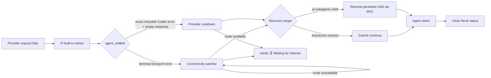

<div align="center">

# Pi Herdr Fetch Recovery

**Automatically continue interrupted Pi work after recoverable transport or provider failures.**

[](https://pi.dev)
[](https://nodejs.org/)
[](https://herdr.dev)
[](#development)

[Quick start](#quick-start) · [How it works](#how-it-works) · [Configuration](#configuration) · [Troubleshooting](#troubleshooting)

</div>

A temporary connection or provider failure should pause an agent—not end the workflow. This Pi extension waits until Pi has exhausted its built-in retries, then either monitors connectivity or applies a bounded provider cooldown before submitting one `continue` prompt.

When Pi runs inside Herdr, affected sessions are highlighted in the expanded Agents sidebar:

```text
⏳ Waiting for Internet
```

## Features

- Waits for Pi's final `agent_settled` event instead of competing with built-in retries.
- Recognizes structured provider transport failures, `fetch failed`, `tunnel_destination_denied`, WebSocket, DNS, socket, and connection-reset errors.
- Recognizes the exact empty-response Codex processing error that explicitly says the request can be retried.
- Ignores authentication, quota, rate-limit, HTTP, context-window, cancellation, partial-response, and unknown provider errors.
- Gives manual input and manual compaction priority over automatic recovery.
- Bounds automatic continuations and applies exponential guard delays to prevent retry loops.
- Recovers failed foreground and async [pi-subagents](https://github.com/nicobailon/pi-subagents) children through its acknowledged `resume` RPC.
- Publishes a leased, display-only Herdr token without changing native agent states or sorting.
- Leaves ordinary RPC, JSON, and print-mode processes untouched.

## Quick start

### Requirements

- [Pi](https://pi.dev) with extension support
- Node.js 22.19 or newer
- Optional: [Herdr](https://herdr.dev) with its official Pi integration for sidebar status
- Optional: pi-subagents 0.46.0 or newer for automatic child-run revival

Tested with Pi 0.84.1, Herdr 0.9.1, pi-subagents 0.46.0, and Node.js 24 on Linux.

### 1. Install the Pi package

```bash
pi install git:github.com/applifaction/pi-herdr-fetch-recovery
```

For local development, install the checkout instead:

```bash
git clone https://github.com/applifaction/pi-herdr-fetch-recovery.git
cd pi-herdr-fetch-recovery
pi install .
```

> [!IMPORTANT]
> Existing Pi processes do not load newly installed extensions automatically. Wait until the session is idle, then run `/reload`. New sessions load the extension on startup.

### 2. Add the Herdr sidebar row (optional)

Back up `~/.config/herdr/config.toml`, then add the token row to the existing `[ui.sidebar.agents].rows` array:

```toml
[ui.sidebar.agents]
rows = [
  ["state_icon", "machine", "workspace", "tab"],
  [{ token = "$pica_fetch_recovery", rules = [
    { equals = "⏳ Waiting for Internet", fg = "#268bd2", bold = true },
    { contains = "", hide = true },
  ] }],
]
```

Preserve any existing Voice Status, Context Attention, Priority+, or custom rows. If `rows_by_agent` is configured, add the token row to the relevant override as well.

Apply the configuration:

```bash
herdr server reload-config
```

> [!NOTE]
> This is a Pi extension with a Herdr metadata bridge—not a Herdr workflow plugin. It uses Herdr's supported `pane.report_metadata` API, so `herdr plugin link` is neither required nor recommended.

### 3. Verify the active session

```text
/reload
/fetch-recovery-status
```

The status command reports the watcher, probe count, continuation budget, Herdr delivery, subagent recovery state, and the redacted probe target without making a model call.

## How it works



### Interactive sessions

1. Pi performs its normal automatic retries.
2. The extension waits for `agent_settled`, confirming that no retry, compaction, or queued follow-up remains.
3. For transport failures—including Codex `tunnel_destination_denied`—it probes the active provider endpoint after a guard delay.
4. For the exact retryable Codex processing error, it waits for a provider cooldown instead; it does not misdiagnose the error as lost internet.
5. It submits one literal `continue` prompt. The warning remains visible until `before_agent_start` confirms that Pi accepted it.

With Pi's default `retry.maxRetries = 3`, recovery begins only after the initial request and its three retries have failed and the agent has settled. The Codex provider path additionally requires `provider: openai-codex`, `api: openai-codex-responses`, and an empty `content` array, preventing a partial response or tool call from being repeated automatically.

### pi-subagents children

The interactive parent listens for pi-subagents' public foreground and async completion events. For each failed child it:

1. reads the active branch of the persisted child session;
2. verifies that the final assistant response is a recognized transport failure or the exact empty retryable Codex processing failure;
3. waits for connectivity or the provider cooldown, respectively;
4. calls pi-subagents' acknowledged `resume` RPC with the original run ID, child index, and `continue`.

This revives the exact child session instead of fabricating or rewriting its history.

### Herdr status

The extension publishes the `pica_fetch_recovery` token as `⏳ Waiting for Internet` with a 45-second lease and renews it every 15 seconds while recovery is pending. The interactive parent owns one aggregate token, so parent and child recovery cannot clear each other's warning. A crashed Pi process cannot leave the row permanently behind.

## Configuration

The connectivity target is selected in this order:

1. `PI_FETCH_RECOVERY_URL`, when set to an HTTP(S) URL;
2. the active model/provider base endpoint;
3. `https://connectivitycheck.gstatic.com/generate_204`.

| Variable | Default | Description |
| --- | ---: | --- |
| `PI_FETCH_RECOVERY_URL` | Provider endpoint | Explicit health endpoint |
| `PI_FETCH_RECOVERY_POLL_MS` | `5000` | Base delay between probes |
| `PI_FETCH_RECOVERY_PROBE_TIMEOUT_MS` | `3000` | Timeout for one transport probe |
| `PI_FETCH_RECOVERY_PROVIDER_RETRY_MS` | `30000` | Base cooldown for an explicitly retryable provider failure |
| `PI_FETCH_RECOVERY_MAX_CONTINUES` | `3` | Automatic continuation cycles before pausing |

A 2xx or ordinary 4xx response proves route reachability because many provider base endpoints require authentication or a more specific path. Redirects, proxy-auth, timeout, early-data, rate-limit, and 5xx responses do not trigger a continuation.

Each newly failed automatic continuation doubles the next guard delay. Transport delays are capped at 60 seconds; provider cooldowns are capped at 300 seconds. When the continuation budget is exhausted, the extension leaves the error visible and waits for manual input.

> [!WARNING]
> Probes use Node's global `fetch` without provider credentials. If the provider is reachable only through an application-specific or corporate proxy that Node is not configured to use, set `PI_FETCH_RECOVERY_URL` to a directly reachable internal health endpoint.

## Safety boundaries

- Recovery is at most once per settled agent generation and bounded across generations.
- A successful response or manual input resets the continuation budget.
- Human input and manual compaction cancel pending automatic recovery.
- Embedded URL user information is stripped; provider authentication headers are never copied into probes.
- A stale Codex WebSocket diagnostic cannot override a final authentication or HTTP error from its SSE fallback.
- HTTP reachability does not guarantee that the next model request succeeds. A repeated transport failure starts another bounded recovery cycle.
- Provider retries are intentionally allow-listed by exact provider, API, message, and empty response. Unknown or partially emitted failures require manual review to avoid duplicate text or tool side effects.
- The Pi extension API does not provide a transactional acknowledgement for interactive `sendUserMessage`; the implementation prefers avoiding duplicate prompts after an ambiguous process failure.

## Troubleshooting

| Symptom | Check |
| --- | --- |
| `/fetch-recovery-status` is unknown | Run `/reload` in the idle Pi session, or start a new session. |
| Status says `active: false` | Recovery runs only in interactive TUI sessions; JSON/RPC/print children are handled by their parent. |
| Herdr delivery is acknowledged but no row appears | Add `$pica_fetch_recovery` to the expanded Agents rows and reload Herdr's config. |
| A failure does not trigger recovery | Confirm the final error is either a transport failure or the exact empty Codex retry invitation—not HTTP, auth, quota, rate limit, context overflow, cancellation, or a partial response. |
| Status says `waiting before provider retry` | The backend returned the allow-listed Codex processing error. No connectivity probe is made; the default cooldown is 30 seconds. |
| The watcher never reports connectivity | Check the displayed target and configure `PI_FETCH_RECOVERY_URL` when a proxy or custom route is required. |
| Automatic recovery pauses | The continuation budget was exhausted. Submit a prompt manually to reset it. |
| A child is not resumed | Confirm pi-subagents exposes foreground/async completion events and the `resume` RPC, and that the child session file still exists. |

## Development

Run the isolated unit and integration suite:

```bash
npm test
```

Run the real Herdr protocol and lease smoke test:

```bash
npm run test:herdr
```

The Herdr test starts its own server with temporary HOME/XDG directories and sockets. It verifies token publication, renewal, orderly clearing, and crash expiry without connecting to a live Herdr session.

### Project structure

```text
index.ts                       Pi lifecycle adapter and aggregate state
connectivity.ts                Provider target resolution and bounded probes
network-error.ts               Transport and allow-listed provider-error classification
recovery-watcher.ts            Cancellable connectivity loop
subagent-recovery.ts           pi-subagents completion and resume bridge
metadata.ts                    Leased Herdr metadata publisher
tests/integration.test.mjs     Pi lifecycle and subagent recovery tests
tests/metadata.test.mjs        Socket delivery, retry, and ordering tests
tests/herdr-smoke.test.mjs     Isolated real-Herdr verification
```
